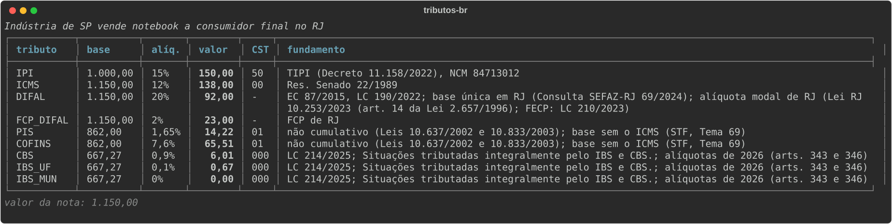
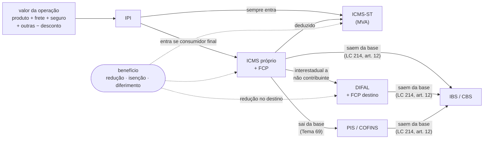
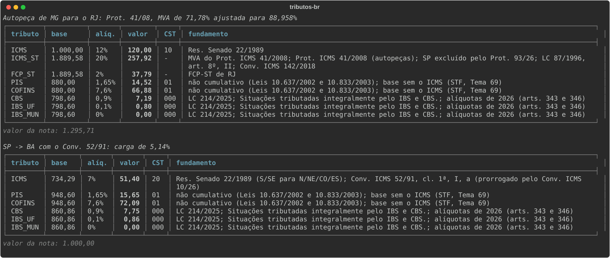
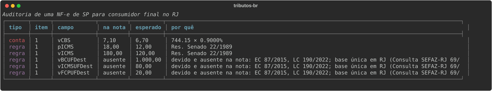

# tributos-br

[](https://github.com/xhinzz/tributos-br/actions/workflows/ci.yml)


[](LICENSE)

Calcula os tributos de uma NF-e de mercadoria a partir dos dados da operação: **IPI, ICMS próprio, FCP, DIFAL,
ICMS-ST, benefícios fiscais, PIS/COFINS e IBS/CBS da Reforma Tributária**. Todo valor devolvido vem com a base, a
alíquota, o CST/CSOSN e o **fundamento legal** que o produziu, e toda alíquota tem vigência: a mesma nota calculada
com outra data usa a regra daquela data.

> *English: a dependency-free Python library that computes Brazilian goods-invoice (NF-e) taxes (IPI, ICMS with
> FCP, DIFAL and tax substitution, tax incentives, PIS/COFINS and the new IBS/CBS) with the legal basis attached to
> every value and every rate versioned by date. Docs are in Portuguese because the domain is.*

```python
from datetime import date
from tributos_br import Item, Nota, Participante, calcular

nota = Nota(
    emitente=Participante("SP", regime="real", industria=True),
    destinatario=Participante("RJ", contribuinte_icms=False),  # consumidor final
    itens=[Item(ncm="8471.30.12", valor="1000.00")],
    data=date(2026, 10, 23),
)
for nome, t in calcular(nota).itens[0].tributos.items():
    print(f"{nome:9} {t.base:>8} × {t.aliquota:>4}% = {t.valor:>7}  CST {t.cst or '-':4} {t.fundamento}")
```

```
IPI        1000.00 ×   15% =  150.00  CST 50   TIPI (Decreto 11.158/2022), NCM 84713012
ICMS       1150.00 ×   12% =  138.00  CST 00   Res. Senado 22/1989
DIFAL      1150.00 ×   20% =   92.00  CST -    EC 87/2015, LC 190/2022; base única em RJ (Consulta SEFAZ-RJ 69/2024); alíquota modal de RJ (Lei RJ 10.253/2023 (art. 14 da Lei 2.657/1996); FECP: LC 210/2023)
FCP_DIFAL  1150.00 ×    2% =   23.00  CST -    FCP de RJ
PIS         862.00 × 1.65% =   14.22  CST 01   não cumulativo (Leis 10.637/2002 e 10.833/2003); base sem o ICMS (STF, Tema 69)
COFINS      862.00 ×  7.6% =   65.51  CST 01   não cumulativo (Leis 10.637/2002 e 10.833/2003); base sem o ICMS (STF, Tema 69)
CBS         667.27 ×  0.9% =    6.01  CST 000  LC 214/2025; Situações tributadas integralmente pelo IBS e CBS.; alíquotas de 2026 (arts. 343 e 346)
IBS_UF      667.27 ×  0.1% =    0.67  CST 000  LC 214/2025; Situações tributadas integralmente pelo IBS e CBS.; alíquotas de 2026 (arts. 343 e 346)
IBS_MUN     667.27 ×    0% =    0.00  CST 000  LC 214/2025; Situações tributadas integralmente pelo IBS e CBS.; alíquotas de 2026 (arts. 343 e 346)
```

O IPI entra na base do ICMS porque o destino é consumidor final; o DIFAL e o FCP do RJ vão para o destino; PIS e
COFINS saem sem o ICMS; e a base do IBS/CBS desconta ICMS, DIFAL, FCP, PIS e COFINS, como manda o art. 12 da LC 214.



<sub>Prints gerados do cálculo de verdade por `scripts/gerar_imagens.py`. Valor marcado para conferir sai em
amarelo.</sub>

## Como o cálculo anda

A ordem importa, porque cada tributo entra (ou sai) da base do seguinte:



## O que cobre

| Tributo | O que a biblioteca resolve | Fonte dos dados |
|---|---|---|
| **IPI** | Alíquota pelo NCM e EX, NT (CST 53), alíquota zero (51), Simples sem destaque, zerado a partir de 2027 (EC 132) | TIPI oficial da Receita (11.102 NCMs), gerada por script |
| **ICMS interestadual** | 4%, 7% ou 12% pela origem da mercadoria e pelo par de UFs | Res. Senado 22/1989 e 13/2012 |
| **ICMS interno e FCP** | Alíquota modal das 27 UFs com vigência (AL, MA, PI e RN mudaram em 2025/2026), FCP geral (AL, RJ, SE), alíquota própria do produto | Lei de ICMS de cada UF, citada linha a linha |
| **Base do ICMS** | Frete, seguro, outras despesas, desconto incondicional e IPI na base quando o destino é consumidor final (CF art. 155, §2º, XI) | LC 87/1996, art. 13 |
| **DIFAL** | Venda a não contribuinte com os três métodos usados pelas UFs (base única, base dupla e por dentro), FCP do destino, Simples fora (ADI 5.464) | Método de cada UF tirado do RICMS, de consulta ou de norma de execução estadual (22 das 27 confirmadas) |
| **ICMS-ST** | MVA original e ajustada, IPI na base, dedução do ICMS próprio (inclusive a presumida do Simples), redução de base, FCP-ST líquido do FCP próprio, conferência de CEST × NCM | Conv. ICMS 142/2018 (1.030 CESTs extraídos do texto do CONFAZ); MVA informada ou da tabela |
| **Benefícios** | Redução de base (CST 20/70), isenção (40), não tributada (41), diferimento (51) com vICMSOp/vICMSDif, valor desonerado, cBenef, carga efetiva | Conv. ICMS 52/91 (Anexos I e II, 581 NCMs) e 100/97 (cl. 1ª, 2ª e 3ª-A) prontos; os demais, informados |
| **Simples Nacional** | CSOSN 101/102/201/202/400 e crédito do art. 23 da LC 123 só quando cabe | LC 123/2006 |
| **PIS/COFINS** | Lucro Real (1,65% + 7,6%) e Presumido (0,65% + 3%), base sem o ICMS, monofásico, alíquota zero, isenção, suspensão, Simples (CST 49) | Leis 10.637, 10.833, 9.715 e 9.718; STF Tema 69 |
| **IBS/CBS** | Alíquotas de teste de 2026, base do art. 12 da LC 214 (sem IPI, ICMS, FCP, DIFAL, PIS e COFINS), os 173 cClassTrib oficiais com redução (cesta básica a zero, 60% para alimentos, higiene, insumos agro), conferência do NCM nos anexos da LC 214, Simples fora em 2026 | IT 2025.002 (planilha do Portal da NF-e) e anexos da LC 214, gerados por script |
| **Auditoria de NF-e** | Lê o XML (com ou sem `nfeProc` e namespace), confere a conta da própria nota e recalcula pela legislação: alíquota interestadual, DIFAL esquecido, CST/CSOSN, base do IBS/CBS, cClassTrib, CEST | NT 2016.002, NT 2025.002 e as mesmas tabelas do cálculo |
| **CNPJ** | Validação do numérico e do **alfanumérico** (IN RFB 2.229/2024) e preenchimento da UF e do Simples pela BrasilAPI | — |

Cada tabela traz a fonte de cada linha. Onde a pesquisa não achou confirmação oficial, a linha é marcada e o
resultado avisa (veja [Limites](#limites)).

## Instalação

```bash
pip install git+https://github.com/xhinzz/tributos-br
```

Python 3.10 ou mais novo, sem dependências.

## Uso

### Participantes e itens

```python
from datetime import date
from tributos_br import Beneficio, Item, Nota, Participante, calcular

emitente = Participante("SP", regime="presumido")  # simples | presumido | real
cliente = Participante("BA", contribuinte_icms=True)  # vai revender: sem DIFAL, IPI fora da base
item = Item(
    ncm="25221000",
    valor="1000",
    origem=0,  # origem da mercadoria (tabela 0 a 8 da NF-e)
    frete="50",
    seguro="0",
    outras="0",
    desconto="20",
    cest="1000100",  # conferido contra o NCM no Conv. 142/2018
)
resultado = calcular(Nota(emitente, cliente, [item], data=date(2026, 10, 23)))
resultado.totais  # soma por tributo
resultado.valor_nota  # vNF: produtos − desconto + frete + seguro + outras + IPI + ST + FCP-ST
resultado.como_dict()  # pronto para JSON, com Decimal em texto
```

Valores e percentuais aceitam `str`, `int`, `Decimal` ou `float` (convertido sem herdar o erro binário). Percentual
é escrito como na lei: `18` é 18%.

### Benefícios fiscais

O enquadramento num benefício depende de condições que só quem emite conhece (a destinação, o registro no MAPA, a
descrição exata do produto). Por isso a biblioteca não aplica benefício sozinha: você declara o código da regra, e
ela confere NCM, operação, alíquota e vigência antes de calcular.

```python
from tributos_br import sugerir_beneficios

sugerir_beneficios("84378010", date(2026, 10, 23))
# [('conv52_91_anexo_i', 'Máquinas, aparelhos e equipamentos industriais ...', 'ncm'),        <- NCM na lista do ato
#  ('conv100_97_cl1', 'Insumos agropecuários da cl. 1ª ...', 'descricao'), ...]                <- confira a descrição

Item("84378010", "1000", beneficio="conv52_91_anexo_i")  # carga de 5,14%, 8,80% ou interna, conforme a operação
Item("87019100", "1000", beneficio="conv52_91_anexo_i")  # ao calcular: ValueError, NCM 87019100 fora da lista da regra
```

Para um benefício estadual que a base não tem, monte-o na mão:

```python
Beneficio("reducao_base", percentual="41.67", cbenef="PR830001", fundamento="RICMS/PR, Anexo VI, item X")
Beneficio("isencao", cbenef="SP099999")
Beneficio("diferimento", percentual="100")
```

No DIFAL e na ST, a redução da UF de destino entra quando a regra também vale lá (o Conv. 52/91, cl. 5ª, manda o
DIFAL respeitar a carga interna) ou quando você informa `reducao_destino`.

### IBS/CBS por cClassTrib

```python
from tributos_br import sugerir_cclass_trib

sugerir_cclass_trib("04090000", date(2026, 10, 23))
# [('200034', 'Fornecimento dos alimentos destinados ao consumo humano (Anexo VII)')]

Item("04090000", "1000", cclass_trib="200034")  # CST 200, alíquotas com redução de 60%
Item("10063021", "1000", cclass_trib="200003")  # arroz, cesta básica: alíquota zero
```

A redução vem da planilha oficial do cClassTrib, e a alíquota efetiva usa 4 casas, como manda a NT 2025.002.
Quando o cClassTrib aponta para um anexo da LC 214, o NCM é conferido na lista do anexo, respeitando as
exceções da própria lei ("crustáceos 0306.1, exceto 0306.11"); fora dela, o resultado traz `extras["conferir"]`.
Diferimento (CST 510/515), monofásico de combustíveis e alíquota fixa ainda não são calculados.

### Substituição tributária

A ST entra quando o destinatário é contribuinte que vai revender e há MVA, informada no item (`mva="40"`) ou
encontrada na tabela pela UF de destino e pelo CEST. A MVA é ajustada nas operações interestaduais, exceto para
remetente do Simples e quando a alíquota interna do destino não passa da interestadual.



### DIFAL

As UFs não calculam o DIFAL do mesmo jeito. Com R$ 1.000 de São Paulo (7%) para uma UF de 20%:

| Método | Base | DIFAL |
|---|---|---|
| `unica` | 1.000,00 | 130,00 |
| `dupla` | 1.162,50 | 162,50 |
| `por_dentro` | 1.162,50 | 151,13 |

Cada linha de `tributos_br/dados/ufs.csv` diz o método da UF e de onde ele saiu. Hoje:

| Método | UFs |
|---|---|
| `unica` | AC, AL, AM, DF, ES, MT (desde 12/08/2026), PA, PE, RJ, RN, RO, RR, RS, SC, SE; sem confirmação: AP, BA, MA, SP |
| `por_dentro` | CE, GO, MG, PB, PI, PR (desde 07/01/2025), MT (até 11/08/2026) |
| `dupla` | TO; sem confirmação: MS |

Os exemplos numéricos que as SEFAZ publicaram (CE, GO, MT, PR, AL e TO) estão em `tests/test_difal_oficial.py`
e batem centavo a centavo. Nas cinco UFs sem fórmula oficial, o resultado traz `extras["conferir"]`; se a sua
contabilidade segue outra orientação, informe `Nota(..., metodo_difal="dupla")`.

### Auditoria de NF-e

```python
from tributos_br import auditar

relatorio = auditar("35261011222333000181550010000000011000000010-nfe.xml")
relatorio.ok  # False
for a in relatorio.achados:
    print(a.tipo, a.item, a.campo, a.nota, a.esperado, a.detalhe)
```



Três tipos de achado:

| Tipo | Quer dizer | Exemplo |
|---|---|---|
| `conta` | o XML não fecha com ele mesmo | `vCBS` ≠ `vBC × pCBS`; base do IBS/CBS fora da fórmula da UB16-10 |
| `regra` | o recálculo pela legislação dá outro valor | 18% numa venda de SP para o RJ (é 12%); DIFAL devido e ausente; CSOSN 101 sem crédito |
| `aviso` | pode estar certo, mas vale olhar | alíquota interna menor que a modal (produto com alíquota própria); ICMS dentro da base do PIS |

Benefício, cBenef e MVA não têm como ser deduzidos: vêm da própria nota, e deles só se confere a conta. Uma
divergência que só repete outra já apontada (PIS calculado sobre um ICMS errado) não é listada duas vezes. Notas
de entrada, complementares e de devolução têm só a conta conferida. Pela linha de comando, o código de saída é 3
quando há achado de `conta` ou `regra`, o que permite usar a auditoria num pipeline:

```bash
tributos-br nota.xml
```

### CNPJ

```python
from tributos_br import cnpj

cnpj.valido("12.ABC.345/01DE-35")  # True: o CNPJ alfanumérico entra em uso em julho de 2026
cnpj.participante("00.000.000/0001-91", regime="real")  # UF e opção pelo Simples vêm da BrasilAPI
```

O cadastro público não informa se a empresa é Lucro Real ou Presumido nem se tem inscrição estadual: fora do
Simples, `regime` é obrigatório.

### Linha de comando e outras linguagens

```bash
tributos-br nota.json
cat nota.json | tributos-br -
```

```json
{
  "data": "2026-10-23",
  "emitente": {"uf": "SP", "regime": "presumido"},
  "destinatario": {"uf": "RJ", "contribuinte_icms": false},
  "itens": [{"ncm": "84713012", "valor": "1000", "beneficio": "conv52_91_anexo_i"}]
}
```

A saída é JSON com os valores em texto. É o caminho para usar a biblioteca a partir de C#, Java ou PHP sem
reimplementar as regras.

## Tabelas e atualização

```
tributos_br/dados/
├── ufs.csv          alíquota modal, FCP e método do DIFAL por UF, com vigência e lei
├── tipi.csv         TIPI (NCM, EX, alíquota)                       ← scripts/atualizar_tipi.py
├── cest.csv         CEST × NCM × segmento do Conv. 142/2018         ← scripts/atualizar_convenios.py
├── listas/          NCMs do Conv. 52/91 e dos anexos da LC 214      ← atualizar_convenios.py, atualizar_reforma.py
├── cclass_trib.csv  os 173 cClassTrib do IBS/CBS                    ← scripts/atualizar_reforma.py
├── beneficios.csv   regras de benefício (redução, carga, isenção, diferimento) com vigência
└── mva.csv          MVA por UF de destino e CEST, com vigência
```

Mudança de alíquota é uma linha nova no CSV com `vigencia_inicio`, não uma alteração de código; notas antigas
continuam calculando com a regra da época. TIPI e CEST são regenerados a partir dos arquivos oficiais (planilha da
Receita e HTML compilado do CONFAZ), sem digitação.

## Limites

O que a biblioteca **não** faz, para não passar uma confiança que ela não tem:

- **Benefícios estaduais.** Cada RICMS tem centenas de reduções, isenções e créditos presumidos que mudam toda
  semana. A base traz os convênios nacionais; o resto entra por `Beneficio(...)`.
- **MVA.** Cada UF fixa a sua, e não existe fonte oficial centralizada. `mva.csv` traz exemplos conferidos de SP
  (Portarias SRE 88/2025 e 32/2026); nas demais, informe `mva` no item. Base por pauta ou PMPF não é calculada.
- **Método do DIFAL.** AP, BA, MA, MS e SP não publicam fórmula nem exemplo para o não contribuinte; a tabela
  segue a letra da lei e o resultado traz `extras["conferir"]`.
- **Valor desonerado.** Usa a fórmula simples (base cheia × alíquota − ICMS devido). Algumas UFs exigem outra (o RJ
  calcula por dentro).
- **Fora do escopo:** serviços (ISS), Imposto Seletivo (2027), monofásicos na ponta do fabricante ou importador,
  ST em uso e consumo, Zona Franca de Manaus, devolução e complemento.

O cálculo é uma ferramenta de apoio e não substitui a validação do responsável fiscal da empresa.

## Desenvolvimento

```bash
python -m venv .venv && .venv/bin/pip install -e ".[dev]"
pytest              # esperados calculados à mão, com a conta no comentário; DIFAL contra exemplos das SEFAZ
ruff check . && ruff format --check .
python scripts/atualizar_tipi.py        # baixa a TIPI da Receita
python scripts/atualizar_convenios.py   # baixa os Convênios 142/2018 e 52/1991 do CONFAZ
python scripts/atualizar_reforma.py     # baixa o cClassTrib (Portal da NF-e) e a LC 214 (Planalto)
python scripts/gerar_imagens.py         # refaz os prints do README
```

## Licença

[MIT](LICENSE). As tabelas reproduzem atos oficiais, que não são protegidos por direito autoral (Lei 9.610/1998,
art. 8º, IV).
